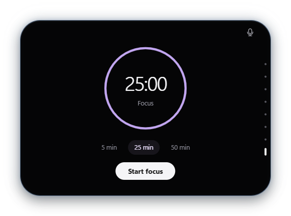
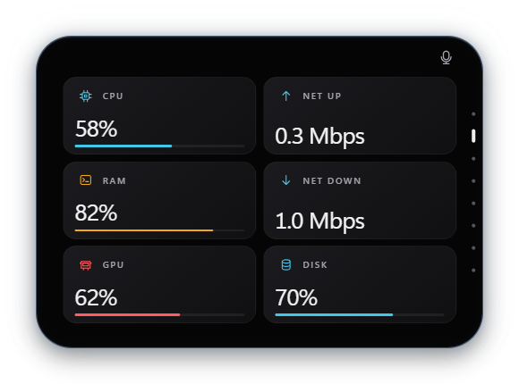

# NOVA Island

**A Dynamic Island-inspired desktop overlay for Windows 11.**

NOVA keeps media, the clock, weather, and time-sensitive activity in a compact pill. Hover to expand it into a dashboard for playback, system controls, and a focus timer.

| Focus timer | System monitor |
| :---: | :---: |
|  |  |

## Features

- **Media** — Control Windows media sessions, seek through tracks, and see album artwork, an audio visualizer, and synced lyrics when LRCLIB has a match.
- **Control Centre** — Manage Wi-Fi, Bluetooth, volume, and brightness on supported displays. Browse connected devices and open common apps from shortcuts.
- **At a glance** — Check local time, weather, a monthly calendar, and live system metrics. See clipboard previews and in-app notices.
- **Focus and AI activity** — Start, pause, or resume a focus session. See activity reported by local Codex and Claude Code sessions, with a compact badge for permission requests and recent completions. [AI activity setup](docs/AI_ACTIVITY.md)
- **Accessibility** — Navigate with the keyboard, use optional Windows voice commands, and follow Windows reduced-motion preferences.

## Run locally

See the [installation guide](docs/INSTALLATION.md) for prerequisite downloads, signed MSIX installation, and troubleshooting.

You need Windows 11 24H2 or newer, the .NET 10 SDK, and the Microsoft Edge WebView2 Runtime.

From the project folder in PowerShell:

```powershell
dotnet build NovaIsland.csproj
dotnet run --project NovaIsland.csproj --no-build
```

Hover over the pill to expand it and move the pointer away to collapse it. Use the navigation dots, mouse wheel, or **↑ / ↓** to move between pages. Press **Esc** to close a connectivity picker or collapse the island. The app falls back to its native WPF interface if WebView2 initialization fails. To launch that interface directly, pass `-- --legacy-ui` to `dotnet run`.

### Windows permissions

- **Weather** uses Windows location access and Open-Meteo. You can supply coordinates through `NOVA_WEATHER_LATITUDE` and `NOVA_WEATHER_LONGITUDE`.
- **Windows toast history** requires package registration and consent. Hotspot availability depends on Windows capabilities and device configuration.
- **Night Light and Airplane Mode** open their respective Windows Settings pages. Radio, pairing, brightness, and voice controls depend on device support and permissions.

## Build an MSIX

```powershell
powershell -NoProfile -ExecutionPolicy Bypass -File Packaging/Build-MSIX.ps1
```

The script builds a self-contained x64 MSIX under `artifacts/`. The default package is unsigned. See the [MSIX guide](Packaging/README.md) for signing and developer registration, and the [implementation status](docs/IMPLEMENTATION_STATUS.md) for installed-package and hardware checks still pending.

## Architecture

NOVA uses **C# and .NET 10** for the WPF host and Windows integrations. The host loads bundled **HTML, CSS, and JavaScript** in WebView2. The frontend requests actions and receives feature state over a validated [JSON message bridge](docs/BRIDGE.md).

| Path | Purpose |
| --- | --- |
| [`UI/`](UI/) | WebView interface, page components, styles, and bridge client |
| [`MainWindow.WebView.cs`](MainWindow.WebView.cs) | WebView host, navigation restrictions, and message transport |
| [`MainWindow.Bridge.cs`](MainWindow.Bridge.cs) | Action validation and feature snapshots |
| [`Services/`](Services/) | Wi-Fi discovery, lyrics parsing, artwork colours, focus timing, and local agent activity |
| [`Packaging/`](Packaging/) | MSIX manifest and build script |
| [`tests/`](tests/) | Isolated checks and WebView integration tests |

## Verify changes

Run the isolated checks for artwork palettes, cursor bounds, lyrics parsing, agent activity, and focus timing:

```powershell
dotnet run --project tests/PaletteChecks/PaletteChecks.csproj
```

For the WebView integration test, build the app and start a development instance in PowerShell:

```powershell
dotnet build NovaIsland.csproj
$env:WEBVIEW2_ADDITIONAL_BROWSER_ARGUMENTS = '--remote-debugging-port=9229'
dotnet run --project NovaIsland.csproj --no-build -- --devtools
```

From a second terminal at the project root, run the smoke test with Node.js 22 or newer:

```powershell
node tests/webview-smoke.mjs --exit
```

The smoke test exercises page navigation, the frontend-to-native bridge, layout, and animation. It saves screenshots under `artifacts/screenshots/`. After closing the development instance, clear the debugging argument in the first terminal:

```powershell
Remove-Item Env:WEBVIEW2_ADDITIONAL_BROWSER_ARGUMENTS
```
